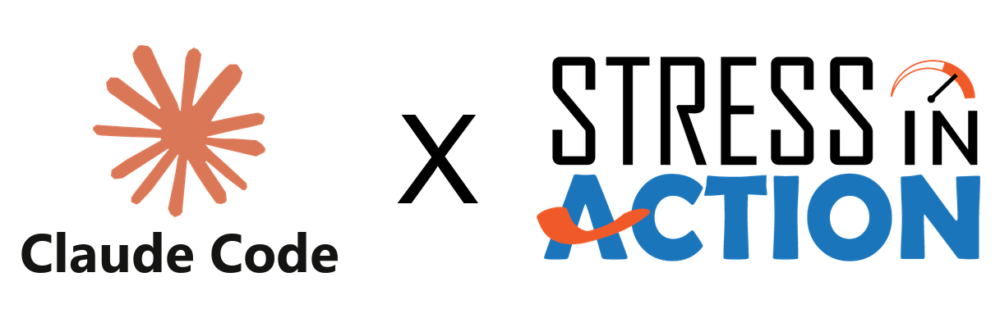

[](https://www.repostatus.org/#active)
[](../../releases)
[](https://www.gnu.org/licenses/gpl-3.0)

<p align="center">
  <picture>
    <source media="(prefers-color-scheme: dark)" srcset="www/ClaudeCodexSiA_dark.png">
    
  </picture>
</p>

# SiA-WD skills

Two [Claude Code](https://claude.com/claude-code) skills for maintaining the Stress in Action Wearables Database (SiA-WD).

| Skill | What it does |
|---|---|
| `sia-wd-build-database` | Pulls the latest data repo, lets the researcher update the mother tables, runs the R pipeline, verifies the result (preflight, validate, roundtrip, release diff, reviewer), then commits and pushes the mother tables and outputs after a yes. |
| `sia-wd-deploy-shiny` | Takes a finished full build into the apps: tests it locally in the test app and the production app (both open in the browser), updates and tests the siawd golem package, commits and pushes (siawd with a version bump and tag), and optionally uploads to the live Shiny server over SSH. |

Run them in that order: build first, then deploy.

## Install

```
git clone https://github.com/stress-in-action/sia-wd-skills
cp -r sia-wd-skills/sia-wd-build-database sia-wd-skills/sia-wd-deploy-shiny ~/.claude/skills/
```

Then ask Claude Code to "build the SiA database", and afterwards to "deploy the SiA database to the app".

## Repos they work on

- Data pipeline: [`sia.project.1.wd.data`](../../../sia.project.1.wd.data)
- Shiny app: [`sia.project.1.wd.shiny`](../../../sia.project.1.wd.shiny)
- Golem package: [`siawd`](../../../siawd)

The live app is at https://wearables.stress-in-action.nl.
